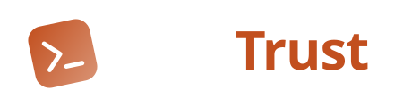

### Software inteligente para empresas que não abrem mão de **eficiência** e **segurança**.

[🌐 Site](https://softrust.io) · [✉️ softtrust@softtrust.io](mailto:softtrust@softtrust.io) · [📍 São José dos Campos – SP](https://softrust.io)

---

## 🦀 Quem somos

A **SoftTrust Technology** é uma empresa de desenvolvimento de software **B2B**. Criamos aplicações inteligentes, rápidas e seguras para organizações que precisam operar com **eficiência**, **confiabilidade** e **controle total** dos seus dados.

Nosso nome diz tudo: **Soft**ware em que você pode **Trust** (confiar).

Apostamos em **Rust** como base tecnológica porque ele entrega o que o mercado corporativo exige: desempenho de linguagem nativa, segurança de memória e sistemas que se mantêm estáveis em produção.

---

## 🔶 O que fazemos

| Frente | Descrição |
|:--|:--|
| 🌐 **Plataformas Web** | Sistemas corporativos escaláveis, com autenticação, controle de acesso, painéis administrativos e APIs. |
| 🖥️ **Aplicações Desktop** | Softwares nativos, leves e rápidos para operações críticas do dia a dia. |
| 🤖 **Automação e Inteligência** | Fluxos inteligentes que reduzem trabalho manual e aceleram decisões. |
| 🔐 **Segurança e Compliance** | Arquitetura pensada desde o início para proteção de dados e aderência regulatória. |
| 🔌 **Integrações** | Conexão entre sistemas legados, serviços em nuvem e plataformas de terceiros. |
| 🛠️ **Produtos e Serviços** | Sistemas prontos para licenciamento e plataformas online sob demanda. |

---

## ⚙️ Princípios de engenharia

- 🛡️ **Segurança por padrão:** memória segura, dependências auditadas e dados protegidos em cada camada.
- ⚡ **Eficiência real:** menos consumo de recursos, mais velocidade e custo de infraestrutura reduzido.
- 🧩 **Código sustentável:** arquitetura modular, testes e documentação que facilitam a evolução do produto.
- 🤝 **Parceria de longo prazo:** o cliente participa do ciclo de desenvolvimento, do desenho à operação.

---

## 🧰 Stack

---

## 🏭 Setores atendidos

`Financeiro` · `Cooperativas` · `Indústria` · `Logística` · `Aeronáutico` · `Naval` · `Serviços`

---

## 📬 Vamos conversar?

Tem um desafio de eficiência ou segurança na sua operação? Fale com a gente.

- ✉️ **E-mail:** [softtrust@softtrust.io](mailto:softtrust@softtrust.io)
- 🌐 **Site:** [softrust.io](https://softrust.io)
- 🕗 **Atendimento:** segunda a sexta, das 8h às 18h
- 📍 **Endereço:** Av. Cassiano Ricardo, 60, Sala 161, The One Office Tower, São José dos Campos – SP

---

**🦀 SoftTrust Technology** · *Tecnologia em que você pode confiar.*

